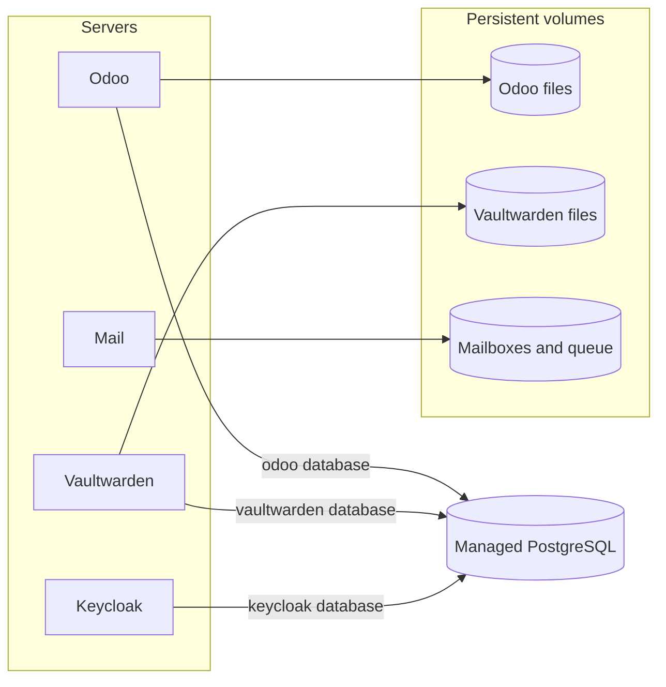
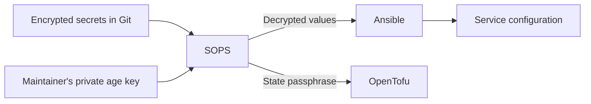

# Hacklab Helsinki infrastructure PoC

Single source of truth PoC for Hacklab infra. Could we have a single repo that defines all Hacklab infra?

## Core philosophy

- Servers are expendable
- Services are isolated
- Limited public access
- Single sign-on
- Monitoring in a single place
- No hand-configuration

## Services

- Odoo: membership, inventory, association workflows (tickets, projects)
- Keycloak: shared login
- NetBird: browser access through its reverse proxy and private network access for maintainers
- Vaultwarden: shared credentials
- Postfix, Dovecot, Rspamd: email
- Gatus: service health and alerts

## Access

Members use services in a browser through NetBird's reverse proxy and sign in through Keycloak. Maintainers use the NetBird VPN for administration.

The `internal` network hosts Odoo, Vaultwarden and Gatus, with NAT for outbound internet access. The `edge` network hosts Keycloak, NetBird and mail, which have public interfaces. A shared router connects the networks; DHCP supplies routes and DNS. PostgreSQL has private connections to both networks. Each server runs a stateful firewall.

## Data and recovery



Servers can be rebuilt from the repository and reconnected to their persistent data. Backups provide recovery when that data is lost or damaged.

## Secrets and maintainer access



Deployment secrets, including the OpenTofu state passphrase, are encrypted with SOPS and age. Each maintainer has their own key; at least two maintainers must be able to decrypt the secrets independently.

When maintainers join, we update the encryption recipients. When they leave, we rotate secrets and re-encrypt the files.

Offline recovery packs give at least two maintainers access through the UpCloud console and a local administrator account if Keycloak or NetBird is unavailable.

## Making changes


OpenTofu provisions infrastructure; Ansible configures servers and services. Plans are reviewed before deployment. Gatus used to check service health.

## File structure

```text
.
├── config.yml             Shared service and hosting definitions
├── infra/                 Servers, networks, storage and PostgreSQL
├── ansible/
│   ├── site.yml           Main configuration playbook
│   ├── inventory/         Server addresses and environment variables
│   └── roles/             Common server configuration
├── services/
│   └── mailserver/        Postfix, Dovecot and Rspamd configuration
│       └── templates/     Templates following server filesystem paths
├── secrets/               Encrypted deployment secrets
├── .sops.yaml             Encryption rules and maintainer public keys
└── scripts/               OpenTofu runner, validation and inventory helpers
```

### Service definitions

[`config.yml`](config.yml) describes each service's hosting and configuration. OpenTofu reads the hosting requirements; Ansible reads the service settings.

```yaml
services:
  odoo:
    server:
      network: internal
      plan: 2xCPU-4GB
      data_gb: 40
      private_ip: 10.42.10.12
    postgresql:
      enabled: true
```

A public-facing service sets `server.public_ip: true`. Application settings and firewall ports go under its `config` branch. Passwords stay in SOPS.

### From definitions to configuration

| File | Purpose |
| --- | --- |
| [`infra/main.tf`](infra/main.tf) | Reads `config.yml` and creates servers, disks and networking. |
| [`infra/outputs.tf`](infra/outputs.tf) | Exposes provisioned addresses and resource IDs for subsequent steps. |
| [`scripts/inventory.py`](scripts/inventory.py) | Builds Ansible inventory from provisioned outputs, or shared definitions for validation. |
| [`ansible/site.yml`](ansible/site.yml) | Loads `config.yml` and applies configuration roles to the hosts. |

### Service templates

Template paths mirror their destination on the server. For example:

```text
Repository:  services/mailserver/templates/etc/postfix/main.cf.j2
Server:      /etc/postfix/main.cf
```

Ansible fills in the template's variables when deploying the file.
